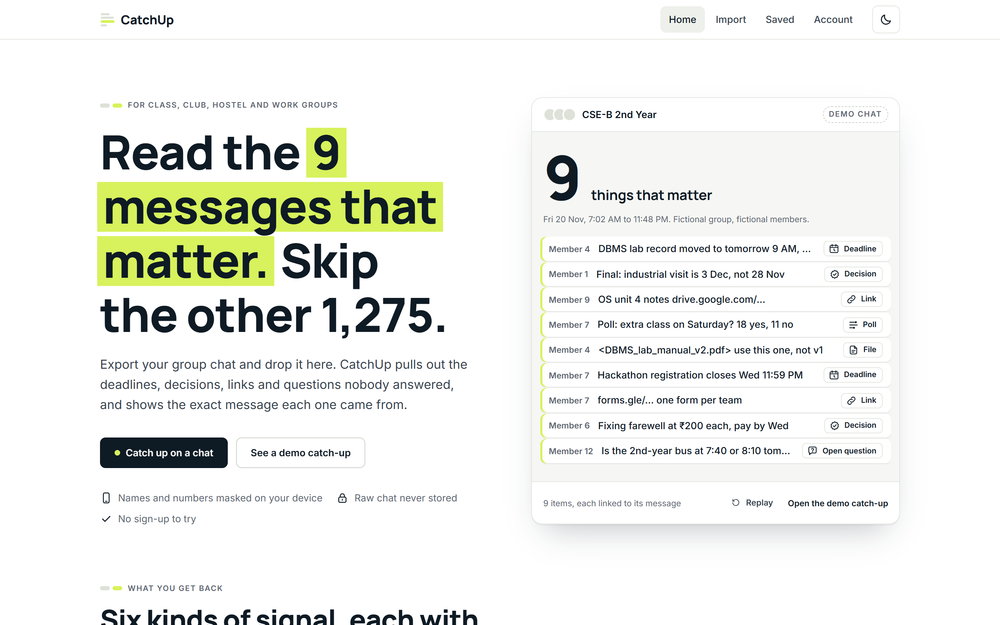
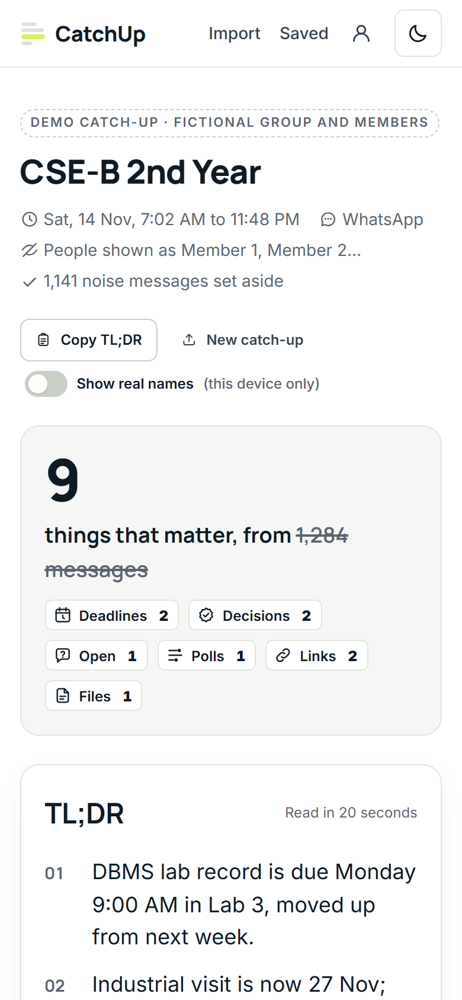
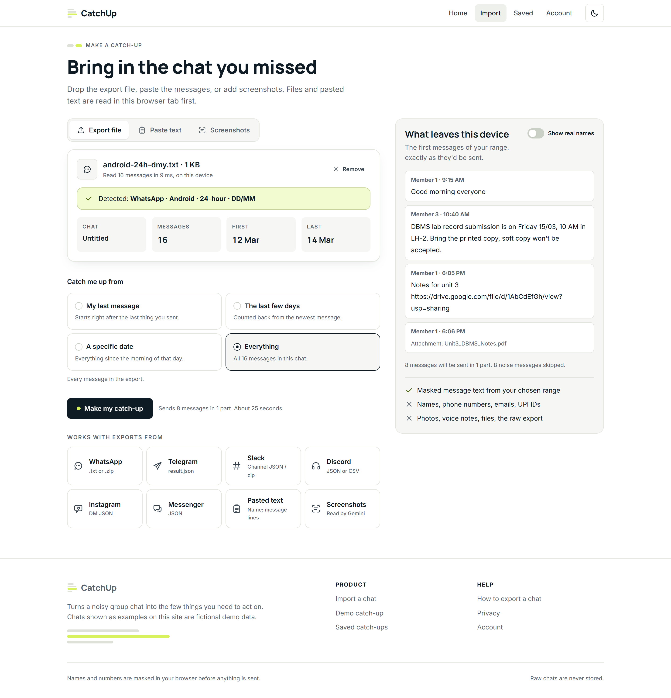
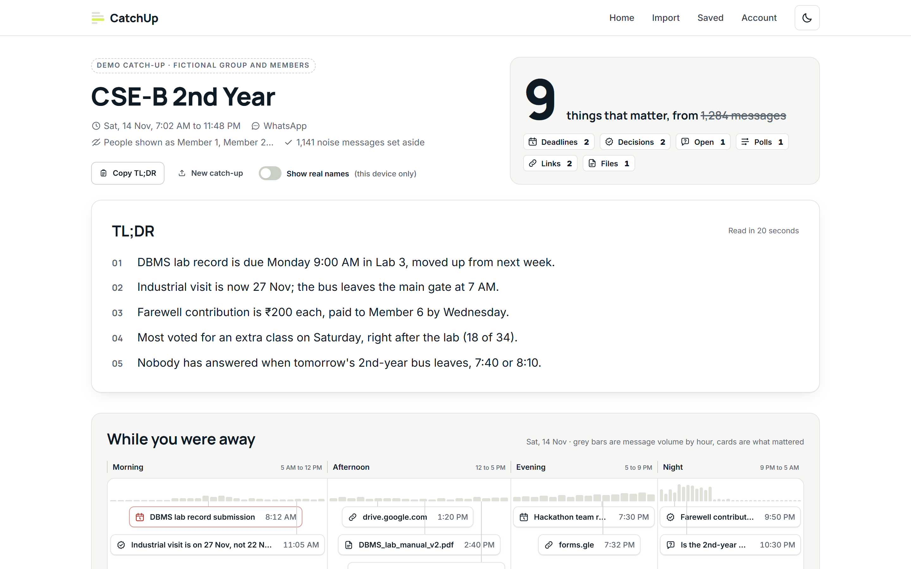
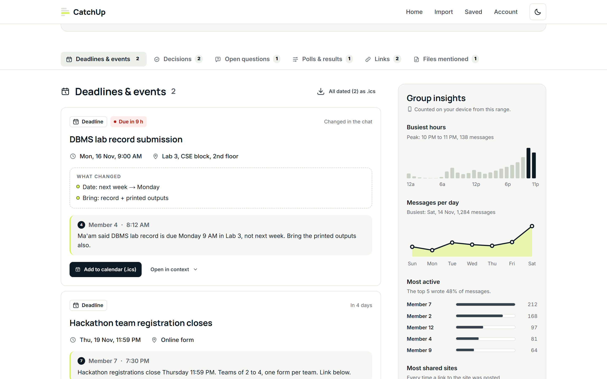
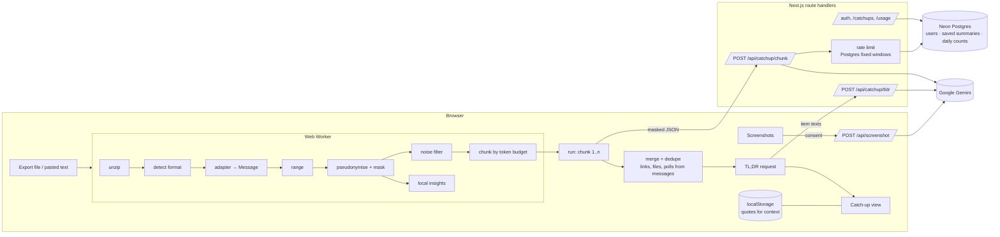

# CatchUp

Turn hundreds of group-chat messages into a short catch-up of what matters: deadlines, decisions, links, files, polls and the questions nobody answered. Works with WhatsApp, Telegram, Slack, Discord, Instagram, Messenger, pasted text and screenshots.

**Live app:** TODO: add the Vercel link after deploying. The `/demo` page there shows a full catch-up of a fictional group without needing an export.
**Static preview (GitHub Pages):** https://devkeerthi-code.github.io/catchup/ (design preview with fictional data; no backend)

## Who is this for and what problem does it solve?

Class, club, hostel and work groups post hundreds of messages a day. The deadline, the venue change, the form link and the decision get buried under stickers, "ok"s and good-morning messages. If you miss half a day, catching up means scrolling for twenty minutes and still missing that the lab moved to the Seminar Hall.

CatchUp is for the students, club members, hostel residents and small teams in those groups. You export the chat from the app you already use (or paste it, or screenshot it) and get a one-screen catch-up where every item links back to the exact messages it came from. It isn't tied to one app, and it doesn't ask anyone else in the group to install anything.

## Screenshots

All screenshots use fictional demo data or the fake test fixtures.

| Home | Catch-up (phone) |
| --- | --- |
|  |  |

| Import: format detected, range and privacy preview |
| --- |
|  |

| Catch-up: TL;DR and day timeline | Deadlines with source quotes and group insights |
| --- | --- |
|  |  |

Dark mode: [docs/catchup-dark.png](docs/catchup-dark.png) · Home on a phone: [docs/home-phone.png](docs/home-phone.png)

## Features

- **Any app.** Built-in adapters for WhatsApp (Android and iPhone exports, 12/24-hour clocks, DD/MM or MM/DD detected automatically, `.txt` or the `.zip`), Telegram Desktop JSON (replies, forwards, polls), Slack workspace/channel exports (threads included), Discord (DiscordChatExporter JSON/CSV and Discord's own data package), Instagram and Messenger "Download your information" JSON (Meta's broken emoji/Indian-script encoding fixed), plain pasted text and screenshots. The format is detected automatically.
- **Pick the range:** since a date, the last N days, or since your own last message.
- **Private by default.** Names become *Member 1, Member 2…*; phone numbers, emails and UPI IDs are masked in your browser **before** anything is sent. No account needed.
- **Catch-up sections:** a 5-line TL;DR, Decisions, Deadlines and events (date, time, place, and what changed; export to `.ics`), Links (deduplicated), Files mentioned, Open questions nobody answered, Polls and results.
- **"While you were away" timeline** (Morning / Afternoon / Evening / Night) and **source cards**: every item quotes the original message, and "Open in context" shows the messages around it.
- **Group insights computed on your device, no AI:** busiest hours, messages per day, most active members (pseudonymous), most shared sites.
- **Optional account** (email and password, bcrypt) to save catch-ups. Only the summary is saved.
- **Light by default**, with a dark theme one tap away in the header (remembered on the device).
- **Fast:** parsing runs in a Web Worker, so even a 50,000-message export stays responsive (see [Performance](#performance)).

## What leaves your device (privacy)

| Step | Where it happens | What is sent or stored |
| --- | --- | --- |
| Reading the export, detecting the app | Your browser (Web Worker) | Nothing |
| Range, noise filtering, insights | Your browser | Nothing |
| Names → *Member N*; phones, emails, UPI IDs → `[phone]` `[email]` `[upi-id]` | Your browser | Nothing |
| Summary | CatchUp server → Google Gemini | Only the **pseudonymised, masked** messages that aren't noise (stickers, "ok", system lines and captionless photos are skipped). The server masks again, never logs it, never stores it. |
| Source quotes for "Open in context" | Your browser's localStorage | Never uploaded, even when you save |
| Saving a catch-up (optional) | CatchUp database | Only the summary: item texts, dates, links and message ids. No chat text, no real names. |
| Usage counts | CatchUp database | Daily totals per action ("catch-up created: 14"). No user ids, no IPs. Rate limits store a salted hash of the IP that can't be reversed. |

**The exception is screenshots.** An image can't be pseudonymised before it's read, so screenshots are sent to Google Gemini to read the text. The app asks for consent first, and CatchUp doesn't store the images. After that, the text goes through the same masking as everything else.

**What masking doesn't catch:** names of people who never posted in the chat ("ask Professor Rao") are not replaced, because there is no reliable way to know a word is a name. The privacy preview shows exactly what will be sent before you press the button.

## How to export your chat

| App | Steps | You get |
| --- | --- | --- |
| WhatsApp (Android) | Open the group → ⋮ → More → Export chat → **Without media** | `.txt` |
| WhatsApp (iPhone) | Open the group → tap its name → Export Chat → **Without Media** | `.zip` (drop it in as is) |
| Telegram | Telegram **Desktop** → open the chat → ⋮ → Export chat history → untick media → Format: **Machine-readable JSON** | `result.json` |
| Slack | Workspace admin: Settings → Import/Export Data → Export | `.zip` |
| Discord | Settings → Data & Privacy → Request all of my data (only your own messages), or a DiscordChatExporter JSON/CSV export | `messages/…` folder or `.json`/`.csv` |
| Instagram / Messenger | Accounts Center → Your information and permissions → Download your information → Messages → Format **JSON** | `.zip` or `message_1.json` |
| Anything else | Copy the messages and paste them, or upload up to 4 screenshots | – |

## Tech stack

- **Next.js 16 (App Router), React 19, TypeScript (strict)**
- **Tailwind CSS 4** with custom design tokens (CSS variables)
- **PostgreSQL on Neon** with **Prisma 7** (driver adapter, migrations)
- **zod 4** for every request body, every model response and the env vars
- **Google Gemini** (`@google/genai`) with JSON-schema structured output
- **Web Workers** for parsing; **fflate** to unzip exports in the browser
- **jose** (signed httpOnly session cookie), **bcryptjs**
- **Vitest** (fake fixture exports only)

## Architecture



**Adding a new app** means writing one adapter (`detect()` returns a confidence score and `parse()` returns the common `Message` format), adding it to `src/lib/chat/registry.ts`, and adding fixtures and tests. Nothing else changes.

```ts
interface Message {
  id: string; time: number; author: string | null; text: string; replyTo: string | null;
  attachments: Attachment[]; reactions: Reaction[]; system: boolean; forwarded?: boolean; poll?: Poll;
}
```

## How the summary works

1. **Map.** Messages that aren't noise are split, in time order, into chunks of about 12k tokens. Each chunk after the first starts with 4 *context-only* messages from the previous one, so replies across the boundary still make sense. Each chunk goes to `/api/catchup/chunk`, and Gemini returns JSON matching a schema: highlights, decisions, deadlines, open questions, files, polls, each with `sourceIds`.
2. **Validate.** Every item is checked on its own with zod. Malformed items are dropped, bad dates become `null`, and **any id the model wasn't shown (or that was context-only) is removed**. An item left with no real source is discarded.
3. **Reduce.** Results are merged on the device: near-duplicates are clustered (word-set similarity), deadlines mentioned twice become one event with a change log (`Venue: LH-2 → Seminar Hall`), and questions that someone replied to are dropped. **Links, file names and formal polls are taken from the messages, not from the model.**
4. **TL;DR.** Only the merged item texts (not the chat) go to `/api/catchup/tldr` for the five lines at the top. If that call fails, the first five highlights are used instead.

**Prompt-injection defence.** Instructions live only in the system instruction, which says the chat is untrusted data. Messages are JSON-encoded with `<` and `>` escaped, inside a single `<chat_data>` block they can't close. The response must match a JSON schema, is validated strictly, and every item must cite messages the model was really shown. A message saying "ignore previous instructions" stays an ordinary chat message, and there is a test for it.

## Design decisions

1. **Parse and pseudonymise in the browser, not on the server.** *Alternative:* upload the export and parse it server-side (simpler, and Python has good parsers). *Trade-off:* every adapter has to be TypeScript and run on phones, but the raw chat never reaches CatchUp's server, so the privacy promise can be checked in the code rather than taken on trust. A Web Worker keeps the page responsive while it runs.
2. **Map-reduce run by the client, one chunk per request.** *Alternative:* one long server request that does everything. *Trade-off:* the client has more logic, but each serverless call stays short (Vercel limits), progress is real ("part 2 of 4"), a rate-limited chunk can be retried on its own, and the server stays stateless.
3. **Links, files and polls are extracted deterministically; the model only does what needs language understanding.** *Alternative:* ask the model for everything. *Trade-off:* a bit more code, but a link can't be hallucinated or injected, deduplication is exact (tracking parameters and `youtu.be` normalised), and fewer tokens go to the free quota.
4. **Rate limits in Postgres (fixed windows, one atomic upsert) instead of Redis or in-memory.** *Alternative:* Upstash Redis or a `Map` in memory. *Trade-off:* about 3 extra DB round-trips per AI call, but there's no extra service to sign up for, it works across serverless instances, and the free Gemini quota (per minute and per day) is protected globally, not just per instance.
5. **Saved catch-ups store only the summary; source quotes stay in localStorage.** *Alternative:* store quotes so saved catch-ups open anywhere. *Trade-off:* on another device a saved catch-up shows the items without "Open in context", but the database never holds chat text, so a leak would expose summaries, not conversations.

## Performance

Measured on a fake 50,000-message WhatsApp export (2.7 MB, generated by `npm run bench`):

| Step | Node 24 (`npm run bench`) | Browser (Web Worker) |
| --- | --- | --- |
| Detect + parse 50,000 messages | 210 ms | 533 ms (main thread never blocked for more than 15 ms) |
| Last 7 days → pseudonymise, mask, insights, chunks | 41 ms | – |
| Whole export → pseudonymise, mask, insights, chunks | 471 ms | – |

Browser figure: Chromium on a Windows laptop, dropping `scripts/out/bench-50k.txt` into the import screen. The AI step depends on Gemini: about 3–15 s per chunk. A typical day in a busy class group (around 1,000 messages, ~600 left after removing noise) fits in one or two chunks.

## Run locally

Requirements: Node 20+ and a Postgres database (a free Neon project is fine).

```bash
cp .env.example .env        # then fill in DATABASE_URL, GEMINI_API_KEY, SESSION_SECRET, HASH_SALT
npm install
npx prisma migrate deploy   # creates the tables
npm run dev                 # http://localhost:3000 (try /demo for a fictional catch-up)
```

Other scripts:

```bash
npm test             # Vitest: adapters, detection, privacy, chunking, merge, .ics, prompt injection
npm run lint         # ESLint
npm run typecheck    # tsc --noEmit
npm run build        # production build
npm run bench        # 50,000-message parse benchmark; also writes scripts/out/bench-50k.txt to try in the app
npx tsx scripts/smoke-gemini.ts   # one live Gemini call on a fake fixture
```

On a slow network, if Prisma can't reach Neon, run the command again: Neon wakes up sleeping databases on the first connection.

## Deploy

**Database: Neon (free)**
1. Create a project at [neon.tech](https://neon.tech) and copy the **pooled** connection string.
2. From your machine: `DATABASE_URL="<that url>" npx prisma migrate deploy`.

**App: Vercel (free Hobby plan)**
1. Push the repo to GitHub, then on [vercel.com](https://vercel.com) choose *Add New → Project* and import it. The framework is detected as Next.js; the build command is `npm run build`, which runs `prisma generate`.
2. Add these environment variables (Production and Preview): `DATABASE_URL`, `GEMINI_API_KEY`, `SESSION_SECRET`, `HASH_SALT`, `ADMIN_EMAILS` (and optionally `GEMINI_MODEL`, `GEMINI_FALLBACK_MODEL`, `AI_CALLS_PER_IP_PER_HOUR`, `GEMINI_CALLS_PER_MINUTE`, `GEMINI_CALLS_PER_DAY`). Use new random values for `SESSION_SECRET` and `HASH_SALT` in production.
3. Deploy, then open `/admin` with an email listed in `ADMIN_EMAILS` to see the usage counts.
4. TODO: paste the live URL at the top of this README.

**Static preview: GitHub Pages (free)**
`pages-demo/` is a static, no-backend preview of the design with fictional data (home, import and catch-up screens). It's published by `.github/workflows/pages.yml`:
1. On GitHub: Settings → Pages → Source: **GitHub Actions**.
2. Push to `main` (or run the workflow by hand from the Actions tab). The URL appears in the workflow run.
3. The preview is live at https://devkeerthi-code.github.io/catchup/

**CI:** `.github/workflows/ci.yml` runs lint, typecheck and tests on every push. It doesn't need any secrets.

## Limitations and what breaks at scale

- **The free Gemini quota is the real ceiling.** Global caps (10 calls a minute, 800 a day by default) mean about 50 concurrent users would queue. Past that you need a paid key, a queue and a per-user quota.
- **Very long ranges are refused.** A run is capped at 10 chunks (~120k tokens of signal). A whole year of a busy group won't fit, and the app asks for a shorter range.
- **Pseudonymisation only knows the people who posted.** Names mentioned but never posting, nicknames ("Rahul" vs "RK") and names inside images aren't replaced.
- **"Open question" is a judgement.** A question answered without using Reply, or in another group, can still show as unanswered.
- **Chat export formats change without notice.** WhatsApp in particular varies by phone language and OS version. Unknown variants fall back to plain-text parsing, and new adapters need new fixtures.
- **Rate limiting in Postgres** costs a few round-trips per AI call. At high traffic, move it to Redis and cache the global counters.
- **Saved catch-ups can't show source quotes on another device**, by design (see Design decisions 5).
- **localStorage** is limited (~5 MB) and per browser. Clearing site data removes local runs.

## What I learned

- Real export formats are messy. WhatsApp alone has invisible direction marks, narrow no-break spaces before "pm", system lines that look like messages, and dates that read the same as DD/MM and MM/DD. Fixture-driven tests made each of those a one-line fix instead of a mystery.
- Meta's export double-encodes text: each UTF-8 byte is written as its own `\u00XX`. Fixing it means re-reading the string as bytes, and only when the result is valid UTF-8, so real accented names aren't damaged.
- Treating model output as untrusted input (schema, strict validation, citations checked against what was actually sent) did more for prompt-injection safety than any wording in the prompt.
- Order of operations matters in privacy code: replacing names *before* masking turned `diya.nair@example.com` into something the email detector no longer recognised. A test that scans the final API payload for every real name and number caught it.

## What I'd improve next

- Run the map step for several chunks in parallel, within the quota, and stream partial sections in as they arrive.
- An on-device OCR option for screenshots (for example Tesseract in a worker), so screenshots can be pseudonymised before anything leaves the phone too.
- A "since last catch-up" mode that remembers where you stopped for each group, and a share link for a read-only catch-up.

## Repo details

**About:** Turn any group chat export (WhatsApp, Telegram, Slack, Discord, Instagram) into a private, source-linked catch-up of deadlines, decisions and links.

**Topics:** `nextjs` `typescript` `privacy` `gemini-api` `web-workers`
